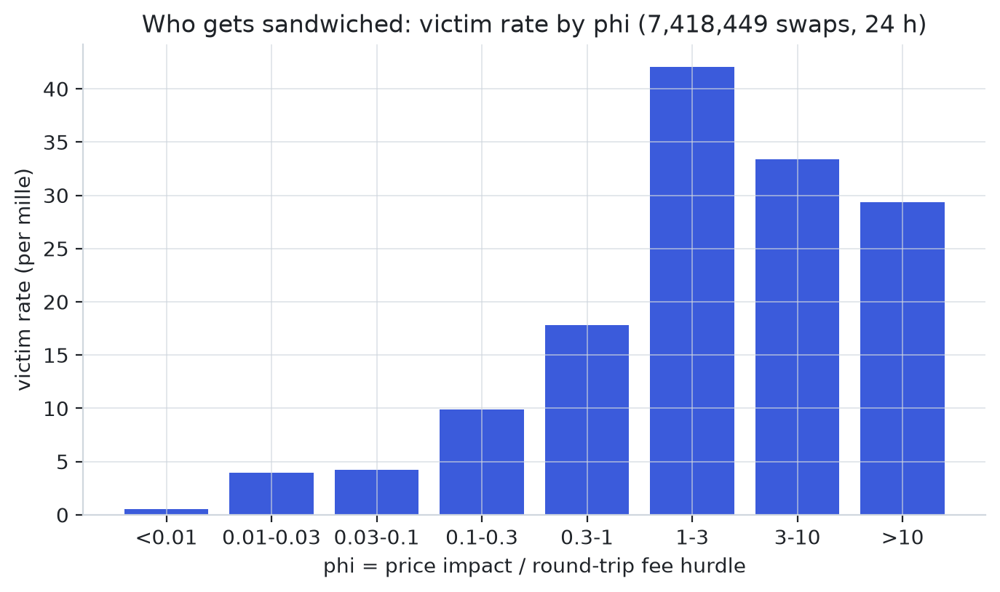
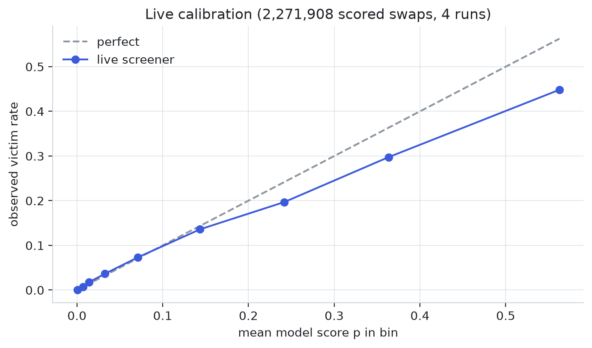
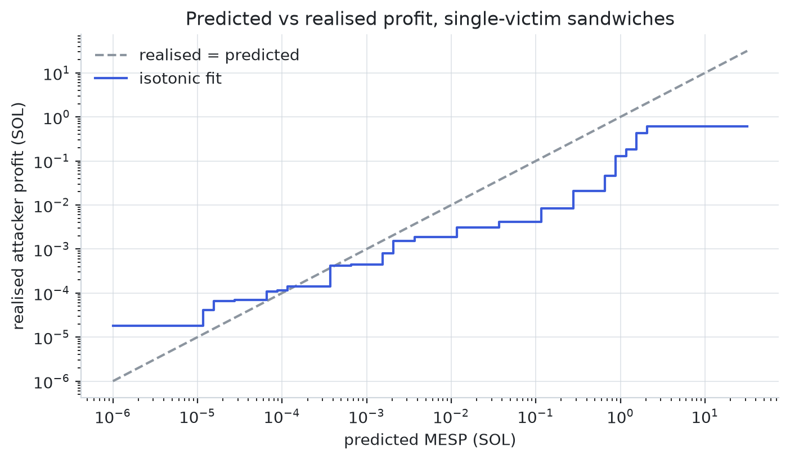

# trenches-sol: Who Gets Sandwiched on Solana

## Why this exists

This is a measurement instrument for market microstructure and liquidity on
Solana's memecoin venues: the pump.fun bonding curve and the PumpSwap AMM.

**It is for analysis only.** It reads confirmed, public blocks. It computes
how exposed each swap is to a sandwich attack, labels the attacks that really
happened, and models which swaps attackers choose. It holds no keys and
contains no code that signs, builds or submits a transaction. Every "profit",
"commit" or "wallet" number on this page is a **simulation** settled against
observed attacks. It exists to quantify the phenomenon, not to perform it.

## The idea

A **sandwich** is front-running on an AMM. An attacker sees a victim's buy,
buys first to push the price up, lets the victim buy at the worse price, then
sells into the move. The victim's own slippage limit is the only thing that
caps the damage.

The textbook question is "how much could be extracted from this swap?" That
turns out to be the wrong question. On 7.4 million swaps from one day, the
swaps with the most extractable value are **not** the ones that get
sandwiched most. Attackers select on three things instead:

1. **Fee-normalised impact.** A swap only pays for a sandwich if the price
   move it causes beats the fee the attacker pays twice, once per leg. One
   number, phi, captures this across pools with very different fees.
2. **Flow.** Attackers front-run bursts of same-side buying, not single
   transactions. Recent pool flow and a pool's attack history are the two
   strongest predictors.
3. **Visibility and capital.** Routed and tipped swaps are attacked less, and
   very large buys are almost never taken: attackers do not carry the
   inventory.

So instead of hand-writing a rule for "interesting", the labels come from the
real attacks, and a model learns the selection.

<picture>
  <source media="(prefers-color-scheme: dark)" srcset="docs/research/figures/readme/phi-dark.png">
  
</picture>

The victim rate climbs from **0.54 per mille** for swaps with phi below 0.01
to **42 per mille** for phi between 1 and 3, a 78x rise, measured over
7,418,449 non-attacker swaps from a 216,000-slot pull (13.0 h of block time). Above phi 3 it falls back
slightly: those are mostly very large buys that attackers lack the capital
to front-run.

## The model in formulas

Units are lamports (1 SOL = $`10^9`$ lamports) unless stated. $`x`$ is the
pool's SOL reserve, $`y`$ its token reserve, $`r`$ the pool's combined fee
rate (30 to 125 bps on these venues).

### 1. Exposure: the exact constant-product sandwich

Both venues price $`x\,y = k`$ and charge $`r`$ on top of a buy's input and
out of a sell's output. For $`n`$ net lamports in, or $`t`$ tokens in:

```math
\text{tokens}(x, y, n) = \frac{y\,n}{x + n}, \qquad
\text{sol}(x, y, t) = \frac{x\,t}{y + t}
```

An attacker front-runs a victim buy with $`D`$ net lamports. The state moves
$`(x, y) \to (x_1, y_1) \to (x_2, y_2)`$ through the front leg and the
victim, then the attacker sells the $`t_1`$ tokens back:

```math
t_1 = \text{tokens}(x, y, D), \qquad
\pi(D) = (1 - r)\,\text{sol}(x_2, y_2, t_1) \;-\; (1 + r)\,D
```

The victim's limit makes only some $`D`$ feasible. For an exact-in buy that
must receive at least $`L`$ tokens, the **slack** is how far its price may
worsen before the limit binds, and the feasible set is an interval:

```math
\text{slack} = \frac{\text{tokens}(x, y, n_v)}{L} - 1, \qquad
D \in [0, D_{\max}],\quad D_{\max} = \sup\{D \le C : \text{victim still fills}\}
```

$`D_{\max}`$ is found by 60 bisection steps, because the victim's price
worsens monotonically in $`D`$. On that interval $`\pi`$ is unimodal, so the
**maximum extractable sandwich profit** is found by 80 golden-section steps:

```math
\text{MESP} = \max_{0 \le D \le D_{\max}} \pi(D), \qquad
\text{ratio } \tfrac{\sqrt 5 - 1}{2}
```

$`C`$ caps the attacker's capital: 5 SOL for exposure (real attackers' p99
front leg is 3.0 SOL, max 6.9 SOL), and a 0.5 SOL budget for the strict
screen below. Without a cap, a victim with no limit "yields" whatever an
attacker dumping half the pool could take, which no bot has the inventory
for. The fee enters the profit directly, so the same victim is worth less on
a 125 bps pool than on a 30 bps pool.

### 2. phi: impact over the round-trip fee hurdle

MESP needs the full curve. phi folds pool depth, trade size and fee into one
closed-form number. For a buy of $`n`$ lamports into reserve $`x`$ (or a sell
of $`o`$ lamports out):

```math
i = \Big(1 + \frac{n}{x}\Big)^2 - 1 \;\;\text{(buy)}, \qquad
i = 1 - \Big(1 - \frac{o}{x}\Big)^2 \;\;\text{(sell)}
```

```math
h = \frac{1 + r}{1 - r} - 1, \qquad
\varphi = \frac{i}{h}, \qquad
\text{room} = \frac{\min(\max(\text{slack}, 0),\, i)}{h}
```

$`h`$ is the price move needed just to pay the fee on both legs. $`\varphi > 1`$
means the swap alone can carry a sandwich. A 0.3 SOL buy has
$`\varphi \approx 0.3`$ on a 90 SOL, 120 bps pool and $`\varphi \approx 20`$ on
a 5 SOL, 30 bps pool. room is phi capped by what the victim's own limit
allows.

### 3. Ground truth: the cross-slot detector

Labels come from real attacks, following the H1/H2 heuristics of Heimbach,
Solmaz, Oz and Ferreira Torres (2026, *No Place to Hide*, arXiv 2609.28115)
with Solana parameters. Since the 2025 validator delistings about 96% of
Solana sandwiches span several slots, so a same-slot detector misses almost
all of them. Our first same-slot attempt found zero in 400 slots.

**H1, structure.** For a wallet trading both directions on one pool, scan its
swaps in chain order $`(\text{slot}, \text{tx}, \text{event})`$. A run of
same-direction swaps is a front leg $`F`$, the next opposite run a back leg
$`B`$. They pair when the back leg resells what the front bought, soon after:

```math
0.5\,\mathrm{tok}_F \le \mathrm{tok}_B \le 1.01\,\mathrm{tok}_F, \qquad
\mathrm{slot}(B_{\text{first}}) - \mathrm{slot}(F_{\text{last}}) \le 8
```

The lower bound tolerates exits spread over several transactions; 8 slots is
two leader rotations. Every swap on the pool **strictly between** the legs,
in the front direction, by another wallet, and not itself a leg, is a
victim. The attacker's profit scales the front cost to the tokens resold:

```math
\text{profit} = \mathrm{sol}_B - \mathrm{sol}_F \cdot \min\!\Big(\frac{\mathrm{tok}_B}{\mathrm{tok}_F}, 1\Big)
```

**H2, one role.** A swap that is a leg of any candidate is never a victim.

**H3, entity filter.** A wallet counts as an attacker only if its round trips
look like a business, not coincidence: at least 3 sandwiches, at least 60%
of them profitable, and legs at least 25% of all its swaps in the window.

Live, the labeller re-runs the detector every block over the last
$`3 \cdot 8 + 16`$ slots and reports each sandwich exactly once, when its
front leg reaches the settling slot $`\text{SETTLE} = 8 + 6 = 14`$ slots
behind the tip.

### 4. The victim-selection model

**Label.** $`y = 1`$ when a swap was a victim of an H3 attacker. The universe
is every swap that is not itself a leg and not sent by a detected attacker.
The weighted base rate on the labelled day (216,000 slots, 13.0 h) is 0.65%.

**Features.** 21 per-swap numbers, computed by the same vectorised code
offline and live. Context windows only look at strictly earlier swaps, so a
feature never sees its own future.

| Group | Features | Why it is there |
|---|---|---|
| Size and depth | `log_sol`, `log_x`, `f_fee_bps` | the raw ingredients; size alone scores AUC 0.745 |
| Fee-normalised impact | `phi`, `log_phi`, `room` | the closed-form selection signal (section 2) |
| Protection | `slack_c` (capped at 10), `slack_known`, `exact_out` | the victim's own limit and its instruction form |
| Extractable value | `log_mesp`, `mesp_rel` | MESP in SOL and relative to the trade |
| Venue and route | `venue_swap`, `direct`, `f_buy` | PumpSwap vs curve, router vs direct, side |
| Fees and tips | `log_cu_price`, `has_tip`, `f_dontfront` | priority fee, Jito tip, the `jitodontfront` flag |
| Pool flow | `log_flow_rel`, `log_pool_n` | same-side flow and trade count, last 8 slots |
| Wallet activity | `log_wallet_n` | the signer's trades in the last 150 slots: scalper or first-timer |
| Pool history | `log_pool_hist` | settled sandwiches on this pool, last 600 slots |

The two context features that matter most are point-in-time by construction:

```math
\text{flow}_j = \sum_{\substack{k \text{ on pool}(j),\; k < j \\ \text{slot}_j - 8 \le \text{slot}_k}} \pm\,\mathrm{sol}_k, \qquad
\texttt{log\_flow\_rel} = \log_{10}\!\Big(\frac{|\text{flow}_j|}{x_j} + 10^{-6}\Big)
```

```math
\texttt{log\_pool\_hist} = \log_{10}\!\Big(1 + \#\{\text{fronts on pool}(j) \text{ in } [\text{slot}_j - 600,\ \text{slot}_j - 14)\}\Big)
```

The sign in $`\text{flow}`$ is $`+`$ for same-side swaps. The 14-slot lag
in pool history is the settle delay: live, a sandwich is only known 14 slots
after its front leg, so training uses the same lag and the feature cannot
leak.

**Learner.** A gradient-boosted tree ensemble (LightGBM, binary log-loss):
learning rate 0.03, 15 leaves, at least 40 rows per leaf, 80% feature and
row bagging, L2 penalty 5, 400 rounds. Trees fit this problem because the
signal is a set of interactions (high phi only matters in a hot pool) on
heavy-tailed inputs, and they need no scaling.

**Split and threshold.** Chronological by slot: train on the first 60%,
score on the last 40%, never a random split. Negatives may be subsampled for
memory and weighted back by $`1 / f_{\text{neg}}`$. The flag threshold
$`\tau`$ is the weighted quantile of held-out scores that flags 2% of
swaps; the saved model is then refit on all rows:

```math
\tau = Q_{1 - 0.02}\big(\hat p_{\text{test}}\big), \qquad
\text{flag} = \mathbf{1}[\hat p \ge \tau]
```

**Scoring.** AUC, average precision (AP) and precision and recall in the top
1% and 5% of swaps by score, every baseline on the same held-out split.

### 5. Visibility and the strict screen

A buy is worth tiering when $`\hat p \ge 0.02`$ or its MESP is at least
10,000 lamports. Its tier depends on how far the follower lags the tip and
whether anything shields it:

```math
\text{tier} = \begin{cases}
\text{visible} & \text{lag} \le 3 \text{ and no Jito tip and not routed through an aggregator}\\
\text{marginal} & \text{lag} \le 8 \text{ otherwise}\\
\text{invisible} & \text{lag} > 8
\end{cases}
```

A visible buy is **strict** when the sandwich recomputed with the 0.5 SOL
budget $`B`$ as capital clears every gate:

```math
\text{MESP}_B \ge 50{,}000, \qquad 0 < D^*_B \le B, \qquad \frac{\text{MESP}_B}{D^*_B} \ge 0.01
```

### 6. From predicted to realised profit

Predicted MESP is a ceiling. To map it to what attackers actually take, an
isotonic (monotone, step-shaped) regression $`g`$ is fitted in log-log space
on single-victim sandwiches, and the landing cost $`c_{90}`$ is the 90th
percentile of real attackers' two-leg cost:

```math
\widehat{\text{gain}} = 10^{\,g(\log_{10} \text{MESP})}, \qquad
c_{90} = Q_{0.9}\Big(\textstyle\sum_{\text{legs}} 5000 + \text{priority fee} + \text{tip}\Big), \qquad
\text{net} = \widehat{\text{gain}} - c_{90}
```

A buy is **optimal** when it is realistic (bounded, non-negative slack, front
smaller than the pool), sandwichable (MESP > 0), profitable (net > 0), and in
the top 10% of qualified buys by net.

### 7. Simulated capital allocation

The allocator asks a counterfactual question: given only strict
opportunities and a 0.5 SOL wallet, which would a disciplined attacker
commit to, and what would that have earned against the attacks that really
happened? For a strict row with score $`p`$, return $`\rho = \text{MESP}_B / D^*_B`$
and $`\nu`$ strict hits on the same pool in the last 300 slots:

```math
q = \min\!\big(\operatorname{clip}(p, 0.02, 0.9)\,(1 + 0.1\min(\nu, 5)),\ 0.95\big)
```

```math
\mu = q\,\rho - (1 - q)\,a \;-\; \beta\,\nu\,(1 - p) \;-\; 0.01\cdot\mathbf{1}[\text{pool already held}]
```

```math
\theta(w) = \theta_\infty + (\theta_0 - \theta_\infty)\,e^{-w / C_0}
```

$`q`$ is the counterparty probability (the model score, boosted by pool
flow), $`a = 0.01`$ the adverse move when nobody comes, $`\beta`$ a crowding
penalty, and $`\theta(w)`$ a hurdle that is strict when the wallet $`w`$ is
small and relaxes as it grows ($`C_0 = 0.5`$ SOL). A row is committed when

```math
p \ge p_{\min},\quad \text{MESP}_B \ge \pi_{\min},\quad \mu \ge \theta(w),\quad
w \le C_0 \Rightarrow D^*_B \le \alpha\,w,\quad \textstyle\sum \text{locked} \le 0.5\ \text{SOL}
```

in descending $`p \cdot \text{MESP}_B`$ order. Each position resolves 15
slots later, one slot after its ground truth settles, against the **observed**
sandwich feed, never a coin flip on whether a sandwich happened:

```math
\text{gain} = \begin{cases}
\max\!\big(0,\ c(\pi)\,\pi - \text{tip}\big) & \text{sandwiched, race won (prob. } W\text{)}\\
-\text{tip} & \text{sandwiched, race lost}\\
-a\,D^* & \text{not sandwiched}
\end{cases}
\qquad c(\pi) = \begin{cases} 0.19 & \pi \ge 0.01\ \text{SOL}\\ 0.6 & \text{otherwise}\end{cases}
```

The capture share $`c(\pi)`$ comes from section 6: along the fitted curve,
attackers realise 4 to 20% of predicted MESP above 0.01 SOL, and 0.19 sits at
the top of that range. The race win rate $`W`$ cannot be observed
from public data, so it is swept, not fitted.

## How well it works

### The selection model beats every single-swap baseline

Held out: the last 40% of the labelled day (216,000 slots, 13.0 h of block time, 7.9M swaps;
1.0M held-out swaps with 25,054 victims, negatives subsampled 30% and
weighted back).

| Score | AUC | AP | Precision at 1% | Recall at 5% |
|---|---|---|---|---|
| Slippage slack alone | 0.536 | 0.008 | 0.016 | 0.052 |
| Router exposure (Heimbach et al.) | 0.656 | 0.017 | 0.044 | 0.177 |
| Standalone MESP | 0.653 | 0.021 | 0.045 | 0.279 |
| Size (SOL) | 0.745 | 0.025 | 0.049 | 0.245 |
| Pool attack history | 0.801 | 0.084 | 0.145 | 0.474 |
| phi | 0.834 | 0.032 | 0.063 | 0.180 |
| Model without pool history | 0.964 | 0.210 | 0.237 | 0.750 |
| **Model, full** | **0.970** | **0.226** | **0.249** | **0.786** |

Two things stand out. First, slippage slack, the usual "am I protected?"
number, is near chance. Second, phi is the best property of a single swap,
and the model's gain over it comes from context: pool flow and pool attack
history carry the most split gain (about 620k and 607k). At the deployed
threshold the model flags 2% of swaps at **18.8% precision and 49.6%
recall**, against a 0.65% base rate: a 29x lift in precision.

### The scores mean what they say, up to about 0.15

<picture>
  <source media="(prefers-color-scheme: dark)" srcset="docs/research/figures/readme/calibration-dark.png">
  
</picture>

Live and out of sample, over 2,271,908 swaps scored in four runs: the
observed victim rate tracks the score from 0 to about 0.15 (score 0.071,
observed 0.073; score 0.144, observed 0.136). Above that the model is
overconfident by about a fifth: score 0.243 against 0.197 observed, and
0.563 against 0.448.

### Attackers do not take what the maths allows

<picture>
  <source media="(prefers-color-scheme: dark)" srcset="docs/research/figures/readme/profit-dark.png">
  
</picture>

Below about 0.0001 SOL attackers realise **more** than the single-victim
prediction (they also eat other flow in the same window). Above 0.01 SOL
they realise only 4 to 20% of it along the fitted curve: they front-run
small, not maximally.
Over one night of 78,143 risk buys, 6,311 qualified as optimal targets, and
those were sandwiched **less** often than other profitable buys (7.4% vs
8.3%). Attackers select on flow and visibility, not on extractable value.

### Protection that works, and protection that does not

Among swaps with phi above 0.3 unless stated:

- **A Jito tip protects:** 8 victims per mille with a tip, 38 without.
- **The `jitodontfront` flag barely does:** 20.5 vs 22.6 per mille over all
  swaps, which fits attacks that span slots and so never meet the bundle rule.
- **Routing protects:** among optimal targets, buys routed through Jupiter
  and two other routers are taken at 2.2 to 2.6%, direct buys at 8.1%.
- **Speed does not:** a high priority fee by itself does not protect; the
  most-hit band (100k to 1M micro-lamports per CU) is the trading-app default.

## Where it fails

- **The allocator has no measured edge.** Tuned on the first 80% of a 5.6 h
  window, the best configuration makes +0.40 ± 0.25 SOL over 88 commits; on
  the held-out 20% it commits 9 times and makes -0.002 SOL. The train result
  is carried by a few rare large targets. Expected profit only turns clearly
  positive above a race win rate of about 0.6, and that rate is unobservable.
  This is a finding, not a strategy: Solana has no public mempool and Jito
  filters sandwiches, so the edge sits with privileged infrastructure.
- **Large buys.** Optimal targets above about 9.9 SOL are almost never taken
  (0.7%),
  so the largest MESP is systematically left on the table. A per-transaction
  MESP overstates them.
- **Flow attacks.** The median PumpSwap sandwich has 2 victims and 3.1 SOL of
  victim flow on a 95 SOL pool. Per-transaction MESP underestimates exposure
  in a burst, because the attacker front-runs the burst.
- **Detection gaps.** Evasive sandwiches that link legs through token
  transfers between wallets are not detected yet, and fee-exempt pump curves
  form a separate regime where phi explodes.
- **One day.** The model is trained and tested on one 216,000-slot pull (13.0 h of block time). A second,
  independent day is the test that would make the numbers a result.

## What is left to finish

1. **Aggregate-flow MESP:** the front-run size that is optimal against the
   expected flow of a burst, as a feature next to phi.
2. **A second held-out day**, to show the selection model transfers.
3. **Recalibrate the top score bins** (isotonic on $`\hat p`$), since scores
   above 0.15 run about 20% hot.
4. **Evasive-sandwich detection** through transfer-linked wallets, and the
   leader effect in the current validator set.

The full findings ledger is `docs/research/findings.md`; the allocator's
derivation is `docs/research/allocation-framework.md` and its tuning is
`docs/research/finetune-report.md`.

## Running it

Python 3.12 and a read-only Solana RPC endpoint.

```bash
python3.12 -m venv .venv && .venv/bin/pip install -e '.[dev]'
cp .env.example .env              # ALCHEMY_RPC_URL or HELIUS_RPC_URL
.venv/bin/python -m pytest -q
.venv/bin/python .                # list every command
```

Offline study, from public blocks to a trained model:

```bash
.venv/bin/python . pull --slots 27000 --out data/raw/blocks_DAY
.venv/bin/python . scan --raw data/raw/blocks_DAY --out data/interim/swaps_DAY
.venv/bin/python . label --swaps data/interim/swaps_DAY --out data/interim/labels_DAY.parquet
.venv/bin/python . evaluate --labels data/interim/labels_DAY.parquet --save data/models/screener.txt
```

Live screener, read-only, with its dashboard on `127.0.0.1:8765`:

```bash
set -a; . ./.env; set +a
.venv/bin/python . live
```

Collected data under `data/` is not versioned; the pipeline regenerates it.

```
sol_mev/        onchain/ (node, decode), measure/ (exposure, sandwich, screen),
                strategy/ (simulated allocator), app/ (live, dashboard, store)
scripts/        research/, finetune/, figures/, ops/, checks/
docs/           research/ (findings, framework, reports), build/ (infrastructure, prompts)
```

## Scope and ethics

- **Read-only on chain.** No keypairs, signing, transaction construction or
  submission exist in this repository.
- **Simulated economics.** Allocator wins and profits are counterfactual
  replays against the observed sandwich feed.
- **Purpose.** Knowing how attackers select victims supports defences:
  better slippage defaults, routing, and wallet warnings for exposed users.
- Wallet addresses are public on-chain identifiers, analysed in aggregate.

This project is academic analysis. It is not a trading tool and not financial
advice.

## License

trenches-sol is **source-available**, licensed under the [PolyForm Noncommercial License 1.0.0](./LICENSE), **not** an OSI open-source license.

- **You may** use, modify, fork, and share trenches-sol freely for any **noncommercial** purpose, as long as you keep the copyright and `Required Notice:` lines (see [`NOTICE`](./NOTICE)) and credit *"trenches-sol by Keygraph, Inc."*
- **You may not** sell it, bundle it into a paid product, or run it as a paid/hosted service **without a commercial license**.

Copyright (c) 2026 Keygraph, Inc. Commercial licensing enquiries: see [`NOTICE`](./NOTICE).
